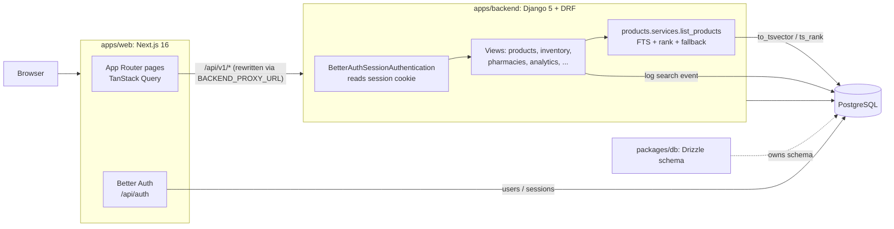

# MedFinder

[](https://github.com/Roo0nnie/medFinder/actions/workflows/ci.yml)

MedFinder is a centralized medical product finder. Customers search one catalog for a medicine by name, generic name, brand, or symptom, and see which verified pharmacies stock it, the price, and how much is in stock. Pharmacy owners and their staff manage products, variants, and inventory from a dashboard. Admins review pharmacy certificates before a pharmacy appears publicly, and they moderate the catalog.

**Live demo:** https://med-finder-web-nbhb.vercel.app/

## Features

**Customers (public)**
- Full-text product search with weighted ranking and a substring fallback for short terms (see [How search works](#how-search-works))
- Product detail page showing available brands and the pharmacies that stock each brand
- Pharmacy directory, a pharmacy detail page with its products, a map view, and a nearest-pharmacy lookup by coordinates
- Pharmacy and product reviews
- Accounts (register, log in, profile) via Better Auth

**Pharmacy owners** (`/dashboard/owner`)
- Manage pharmacies, including logo and owner image upload and certificate upload for verification
- Manage products, variants (strength, dosage form, images), categories, brands, and per-pharmacy inventory
- Manage staff accounts
- Dashboard stock counts (in stock, low, out of stock), analytics, audit log, reviews, and deletion requests

**Pharmacy staff** (`/dashboard/staff`)
- View and update inventory for their owner's pharmacies
- Stock alerts and reports

**Admins** (`/dashboard/admin`)
- Pharmacy certificate review (pending, approved, rejected)
- Manage users, products, categories, and brands
- Platform analytics, audit log, and review moderation

**Analytics captured by the API**
- Every product search is logged with its result count and the owners whose products matched (`product_searches`)
- Product page dwell time, search-result selections, and audit events

## Architecture



- **Web** (`apps/web`) is a Next.js App Router app. Better Auth runs inside it and stores users and sessions in PostgreSQL. Browser calls to `/api/v1/*` stay on the web origin and are rewritten to Django when `BACKEND_PROXY_URL` is set (`apps/web/next.config.ts`). That keeps the session cookie same-origin.
- **API** (`apps/backend`) is Django REST Framework. `BetterAuthSessionAuthentication` (`api/v1/users/authentication.py`) reads the Better Auth session cookie, looks up the `sessions` table, and attaches the user. Roles are `customer`, `staff`, `owner`, and `admin` (`users.role`).
- **Schema ownership:** tables are defined in Drizzle (`packages/db/src/schema.ts`), and most Django models are `managed = False`. Django migrations exist only for the analytics tables (`api/v1/analytics/migrations`).

## How search works

The implementation is `list_products` in `apps/backend/api/v1/products/services.py`, served by `GET /api/v1/products/?query=...`.

1. **Weighted document.** Each product's text is built from PostgreSQL `SearchVector`s (`english` config) with these weights:

   | Weight | Fields |
   | ------ | ------ |
   | A | `name`, `generic_name` |
   | B | `brand_name`, `search_synonyms` |
   | C | `indications`, `active_ingredients` |
   | D | `manufacturer`, `description` |

2. **Query and rank.** The query is parsed with `plainto_tsquery` by default. `searchType=websearch` uses `websearch_to_tsquery` instead, and `prefix=true` turns each token into a `token:*` prefix match. A product is an FTS match when its vector matches the query (`@@`), and it is scored with `SearchRank` (`ts_rank`). With `plainto_tsquery`, a multi-word query requires every word.
3. **Fallback.** Some products are added even without an FTS match:
   - Products with a variant whose `label`, `unit`, `strength`, or `dosage_form` contains the query (case-insensitive) are always added.
   - If the query is a **single token of 2–6 characters**, products whose `name`, `brand_name`, `generic_name`, `search_synonyms`, `indications`, or `active_ingredients` contain it as a substring are also added. This recovers infix terms like `gesic` → "analgesic" that FTS lexemes miss.
4. **Ordering.** Results are sorted by `search_bucket` (0 = FTS match, 1 = fallback-only), then by `rank` descending, then by `name` ascending.
5. **Visibility and logging.** For anonymous users and customers, results are limited to active pharmacies with an approved certificate. Owners see their own pharmacies, staff see their owner's pharmacies, and admins see everything. Every request that has a `query` writes a `product_searches` row.

`searchByName=true` skips all of the above and does a plain `name ILIKE 'query%'` match.

## Tech stack

| Layer | Technology |
| ----- | ---------- |
| Web | Next.js 16 (App Router), React 19, Tailwind CSS 4, TanStack Query, Zod |
| Auth | Better Auth 1.4 |
| API | Django 5, Django REST Framework, Gunicorn |
| Database | PostgreSQL (full-text search, `pg_trgm` indexes); schema in Drizzle ORM |
| Monorepo | pnpm workspaces, Turborepo |
| CI | GitHub Actions |

## Prerequisites

- Node.js ≥ 22.20 and pnpm 10 (`packageManager` is pinned to `pnpm@10.27.0`)
- Python 3.12 (the version used by `apps/backend/Dockerfile` and CI)
- PostgreSQL 16 or newer

## Setup

```bash
# 1. JS dependencies
pnpm install

# 2. Environment files (placeholders only; fill in your values)
cp apps/backend/.env.example apps/backend/.env
cp apps/web/.env.example apps/web/.env
cp packages/db/.env.example packages/db/.env

# 3. Python environment (dependencies are listed in apps/backend/requirements.txt)
cd apps/backend
python -m venv .venv
# Linux/macOS: source .venv/bin/activate    Windows: .venv\Scripts\activate
pip install -r requirements.txt
cd ../..

# 4. Database schema
pnpm db:push                                     # creates tables from packages/db/src/schema.ts
cd apps/backend && python manage.py migrate      # analytics tables + product_searches.matched_owner_ids
cd ../..
```

The Python runtime and virtualenv are not committed. Create `.venv` locally as shown above. `apps/backend/run-dev.mjs` uses it automatically when it exists.

## Environment variables

Each app has a `.env.example` containing placeholder values only.

| File | Variables |
| ---- | --------- |
| `apps/backend/.env` | `DATABASE_URL`, `SECRET_KEY`, `DEBUG`, `ALLOWED_HOSTS`, `PORT` (default 8000), `CORS_ORIGINS`, optional `CSRF_TRUSTED_ORIGINS` |
| `apps/web/.env` | `NEXT_PUBLIC_APP_URL`, `NEXT_PUBLIC_API_BASE_URL`, `NEXT_PUBLIC_API_VERSION`, `BACKEND_PROXY_URL` (required on Vercel), `BETTER_AUTH_SECRET`, `BETTER_AUTH_TRUSTED_ORIGINS`, `BETTER_AUTH_BASE_PATH`, `DATABASE_URL`, `NEXT_PUBLIC_GOOGLE_MAPS_API_KEY` |
| `packages/db/.env` | `DATABASE_URL`, `BETTER_AUTH_SECRET`, `BETTER_AUTH_TRUSTED_ORIGINS` |

## Running

```bash
pnpm dev            # web on http://localhost:8001, API on http://localhost:8000
pnpm dev:web        # web only
pnpm dev:backend    # API only (Django runserver via apps/backend/run-dev.mjs)
```

## Running tests

The backend tests need a real PostgreSQL, because search depends on `to_tsvector` and `ts_rank`. Django creates a temporary `test_<name>` database on the server you point it at and drops it afterwards.

```bash
cd apps/backend
export TEST_DATABASE_URL=postgres://postgres:<password>@localhost:5432/medfinder   # PowerShell: $env:TEST_DATABASE_URL="..."
python manage.py test --settings=config.settings.test -v 2
```

- `config/settings/test.py` reads **only** `TEST_DATABASE_URL`, never `DATABASE_URL`. It refuses to run against any host other than `localhost`, `127.0.0.1`, or `postgres`.
- Because the production schema is owned by Drizzle, `core/test_runner.py` temporarily marks the unmanaged Django models as managed, so the test database is created from the Django model definitions.

Web checks:

```bash
pnpm lint
pnpm typecheck
pnpm build
```

## Testing & CI

The backend suite in `apps/backend/tests/` has **38 tests**, all passing. They cover:

| File | What it proves |
| ---- | -------------- |
| `test_search.py` | `generic_name` (A) outranks `description` (D); brand name and synonym matches; the 2–6 character single-token substring fallback and its limits; fallback results sort after FTS matches; bucket → rank desc → name ordering; multi-word queries don't return unrelated products |
| `test_permissions.py` | Product, inventory, and pharmacy endpoints per role (anonymous, customer, staff, owner, admin), using real session-cookie auth. Covers: staff can't create products; an owner can't modify another owner's products, inventory, or pharmacy; list scoping per role; certificate review is admin-only |
| `test_inventory_status.py` | Stock status rules: out at `quantity <= 0`, low at `quantity <= threshold` (default 5), `unavailable` flag, and owner dashboard counts |
| `test_search_logging.py` | Searches write a `product_searches` row with query, result count, matched owners, and customer id. Listing without a query writes nothing |

GitHub Actions (`.github/workflows/ci.yml`) runs on every push and pull request:

- **web:** `pnpm install --frozen-lockfile`, then `pnpm lint`, `pnpm typecheck`, `pnpm build`. Typecheck and build pass. Lint is a required step and **currently fails**: the existing web code has 116 ESLint errors (mostly `eqeqeq`, direct `process.env` access, and React Compiler "setState in effect" rules), so the web job stays red until they're fixed.
- **backend:** a PostgreSQL 16 service container, `pip install -r requirements.txt`, then `manage.py check`, `manage.py migrate`, and `manage.py test`

## Screenshots

Screenshots go in `docs/screenshots/`:

| File | Screen |
| ---- | ------ |
| `docs/screenshots/home-search.png` | Home page / search results |
| `docs/screenshots/product-detail.png` | Product detail with brands and pharmacies |
| `docs/screenshots/owner-dashboard.png` | Pharmacy owner dashboard |
| `docs/screenshots/admin-dashboard.png` | Admin dashboard / pharmacy verification |

<!-- Uncomment once the images exist:


-->

## Project structure

```
apps/
  web/        Next.js app (customer site + owner/staff/admin dashboards)
  backend/    Django REST API (api/v1/<domain>/, config/, tests/)
packages/
  db/         Drizzle schema, SQL migrations and client
  auth/       Better Auth configuration
  contracts/  Shared Zod schemas / DTOs
tooling/      Shared ESLint, Prettier and TypeScript configs
```

## Deployment

The web app is deployed on Vercel (`vercel.json`). `render.yaml` describes the Django API service, which builds from `apps/backend/Dockerfile`. The workflows `deploy-staging.yml`, `deploy-production.yml`, and `infrastructure.yml` target AWS ECS (see `aws/`).
